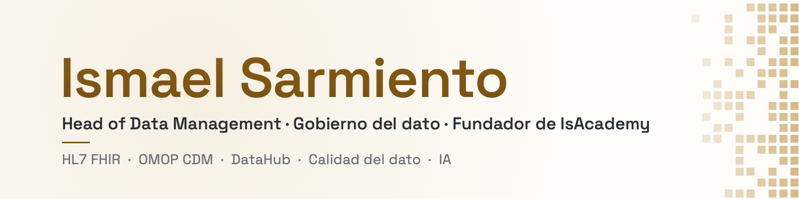

<picture>
  <source media="(prefers-color-scheme: dark)" srcset="assets/banner-dark.png">
  
</picture>

*Head of Data Management at Savana and founder of IsAcademy. I design and build governed, reliable data and AI platforms that help organisations make better decisions and grow with real impact.*

**Head of Data Management** en Savana y fundador de **[IsAcademy](https://ismael-sarmiento.github.io/isacademy/)**.
Diseño y construyo plataformas de datos e IA gobernadas y confiables que ayudan a las organizaciones a decidir mejor y a crecer con impacto real.

Certificación CDMP (Associate) de DAMA International · Miembro activo de DAMA Spain

### Proyectos

| Proyecto | Qué es | Código |
|---|---|---|
| [**Inicio**](https://ismael-sarmiento.github.io/) | Quién soy y la puerta a todo lo demás | [ismael-sarmiento.github.io](https://github.com/ismael-sarmiento/ismael-sarmiento.github.io) |
| [**CV&nbsp;Online**](https://ismael-sarmiento.github.io/cv/) | Mi trayectoria en gobierno, interoperabilidad y calidad del dato, en español e inglés | [cv](https://github.com/ismael-sarmiento/cv) |
| [**IsAcademy**](https://ismael-sarmiento.github.io/isacademy/) | Clases personalizadas de Python, SQL, IA, Big Data y Data Engineering, con consola de Python y depurador en el navegador | [isacademy](https://github.com/ismael-sarmiento/isacademy) |
| [**Kimera&nbsp;Tools**](https://github.com/kimera-tools) | Utilidades de Python para ETL, SQLAlchemy y AWS S3 (2020–2022) | [kimera-python](https://github.com/kimera-tools/kimera-python) |

### Con qué trabajo

Gobierno del dato (DAMA-DMBOK) · HL7 FHIR · OMOP CDM · Catálogo y metadatos · Calidad del dato (UNE 0081) · Python · SQL · Apache Spark · Airflow · IA generativa

### Contacto

[CV Online](https://ismael-sarmiento.github.io/cv/) · [LinkedIn](https://www.linkedin.com/in/ismael-sarmiento/) · [Reservar una clase en IsAcademy](https://ismael-sarmiento.github.io/isacademy/#contacto)
